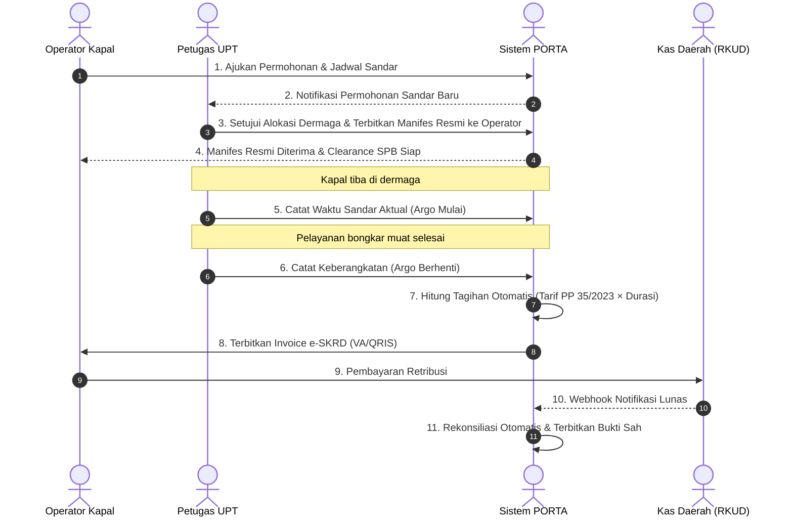

# PORTA - Knowledge Base & Skill Guide

Skill ini adalah sumber kebenaran (*single source of truth*) yang menggabungkan seluruh dokumen spesifikasi produk, model data, kebijakan keamanan manifes, dan panduan desain UI/UX untuk ekosistem aplikasi **PORTA**.

---

## 1. Ringkasan Produk & Latar Belakang

**PORTA** adalah sistem digital terintegrasi untuk pengelolaan pelabuhan penyeberangan yang berada di bawah kewenangan Pemerintah Daerah (Dishub/UPTD).

### Problem Statement
Pemerintah Daerah kerap kehilangan potensi Pendapatan Asli Daerah (PAD) dari retribusi pelabuhan penyeberangan akibat pencatatan manual, pelayanan terfragmentasi, dan ketiadaan rekonsiliasi antara pelayanan fisik kapal dengan penerimaan kas daerah.

### Goals
1. **Meningkatkan Pelayanan Publik:** Digitalisasi jadwal, transparansi tarif, tiket digital (QR Code), dan portal aduan.
2. **Menertibkan Operasional:** Pencatatan alokasi dermaga, waktu sandar aktual, dan pelaporan manifes terpusat.
3. **Optimalisasi PAD:** Otomasi penagihan retribusi berbasis PP No. 35/2023 dan penerbitan e-SKRD.
4. **Dashboard Pimpinan:** Visualisasi metrik kinerja seluruh pelabuhan secara *real-time*.

### Non-Goals
- Tidak menggantikan sistem reservasi angkutan internal kapal (PORTA fokus pada komponen retribusi daerah dan izin pelabuhan, terhubung melalui integrasi API).
- Tidak memonitor radar navigasi lalu lintas laut lepas (*Vessel Traffic Service / VTS*).

---

## 2. Hak Akses & Matriks RBAC (Role-Based Access Control)

| Role | Portal / Aplikasi | Wewenang Utama | Batasan Keamanan |
| :--- | :--- | :--- | :--- |
| **DINAS** | `apps/web` (Dashboard Pimpinan) | Read-only analitik PAD, agregat utilisasi pelabuhan, audit kepatuhan | Dilarang mengubah data operasional harian atau membuka data manifes mentah |
| **UPT** | `apps/web` (Portal Admin UPT) | Persetujuan jadwal sandar, penerbitan & penyerahan manifes resmi ke operator kapal, clearance SPB, pencatatan waktu aktual | Terikat audit log untuk setiap approval, penerbitan manifes, dan penerbitan izin |
| **KAPAL** | `apps/web` (Portal Operator) | Manajemen armada, pengajuan alokasi dermaga, penerimaan & pemantauan manifes resmi dari UPT, bayar retribusi | **Hanya dapat mengakses data kapal dan manifes miliknya sendiri (`company_id`)** |
| **PENUMPANG** | `apps/mobile` & Portal Publik | Pembelian tiket penyeberangan, pembayaran retribusi pas pelabuhan, unduh boarding pass QR | Dilarang mengakses data kapal lain atau manifes muatan |
| **TENANT** | Portal Kios/Lahan | Pemantauan masa kontrak sewa aset dan pembayaran utilitas | Hanya mengakses kontrak aset milik sendiri |

---

## 3. Kebijakan Keamanan Manifes Kapal (High Security)

> [!IMPORTANT]
> Entitas `Manifest` diklasifikasikan sebagai data **RESTRICTED_CONFIDENTIAL** (Keselamatan Pelayaran SOLAS):
> - **Otoritas Penerbitan Manifes (SOP UPT):** Petugas Pelabuhan (UPT) mencatat dan menerbitkan manifes resmi penumpang, kendaraan, serta muatan berdasarkan data gate/terminal, lalu menyerahkannya kepada Operator Kapal terkait.
> - **Isolasi Row-Level Security (RLS):** Operator Perusahaan Kapal hanya boleh membaca/mengunduh manifes yang diterbitkan untuk armadanya sendiri (`company_id`).
> - **Blokir Akses Publik:** Layanan publik dan penumpang diblokir secara ketat dari traversal query manifes.

---

## 4. Alur Kerja Utama (Core Business Workflow)

---

## 5. UI/UX Design System Guidelines

Berdasarkan pedoman dari `ui_ux_design_brief_porta.md`:

### Prinsip Desain
1. **Fungsionalitas di Atas Estetika (Data-First):** Tampilan tabel padat informasi dan mudah dipindai (*scannable*).
2. **Aksi Tidak Ambigu:** Tombol aksi utama (Bayar, Setujui, Tolak) memiliki hierarki kontras yang tegas.
3. **Tangguh di Kondisi Blank Spot (Offline Resilient):** Mendukung penyimpanan lokal sementara (`IndexedDB`/lokal cache) untuk pemindai tiket di gerbang saat sinyal terputus, dengan sinkronisasi otomatis ketika koneksi pulih.

### Design Tokens
- **Primary Color:** Ocean Blue (`#003366` / `#0284c7`) - Otoritas maritim dan rasa aman.
- **Accent/Action:** Turquoise (`#00A3A3` / `#14b8a6`) - Kontras tinggi untuk Call-to-Action (CTA).
- **Surface & Background:** Off-white (`#F8FAFC`) untuk mengurangi kelelahan mata petugas; White (`#FFFFFF`) untuk kartu metrik.
- **Tipografi:** `Inter` (optimal untuk angka tabular data retribusi).
- **Accessibility:** Kontras teks di atas Ocean Blue wajib memenuhi standar **WCAG AAA (> 7:1)**. Cincin fokus (*focus ring*) keyboard navigation berukuran 2px Turquoise.

---

## 6. Berkas Referensi Terperinci

Berkas spesifikasi mentah asli tersimpan di folder skill ini:
- [prd_porta_lengkap.md](file:///c:/Users/Geocitra1/Documents/Github/PORTA/.agent/skills/porta/prd_porta_lengkap.md) - Dokumen PRD komprehensif, daftar fitur MVP/v2/v3, persona, dan user stories.
- [ui_ux_design_brief_porta.md](file:///c:/Users/Geocitra1/Documents/Github/PORTA/.agent/skills/porta/ui_ux_design_brief_porta.md) - Pedoman desain UI/UX, tata letak antarmuka, status komponen, dan standar aksesibilitas.
